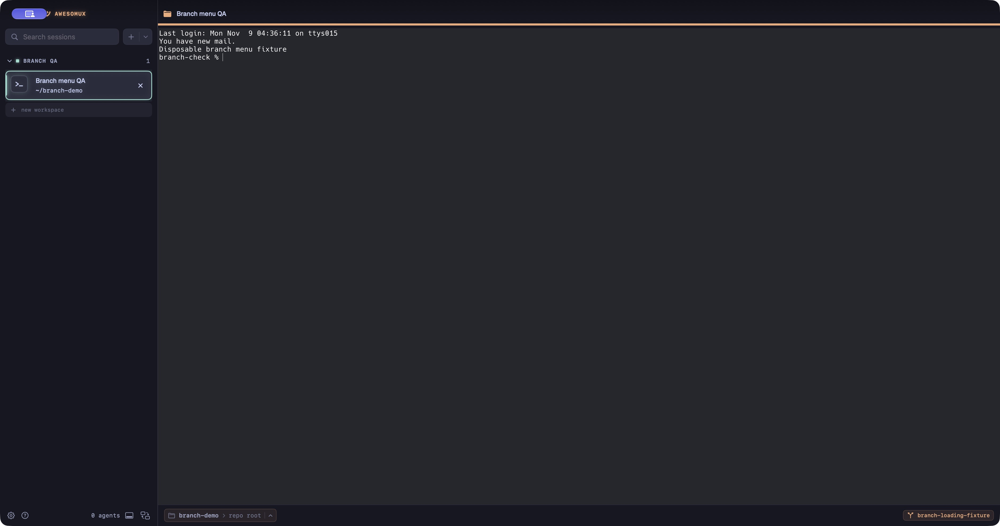
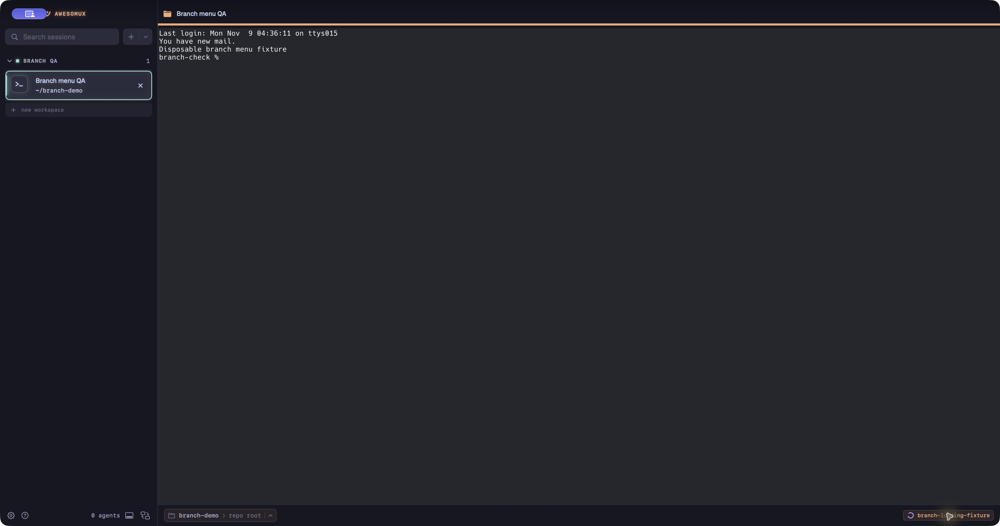

# Branch menu loading

Two states of the same isolated native candidate, using a disposable repository and synthetic shell output. A diagnostic build delays branch enumeration by 12 seconds so the pending state can be inspected. That delay is not part of the product change. These images do not measure real Git latency.

## Ready

## Loading

The button exposes Loading branches as its accessibility value while pending and retains Copy Branch. Completion opens the branch list. Opening a competing path-bar menu clears loading and rejects the older result. Focused state tests cover duplicate activation and stale completion ordering. Actual VoiceOver speech, hardware input and alternate display scales were not checked.
