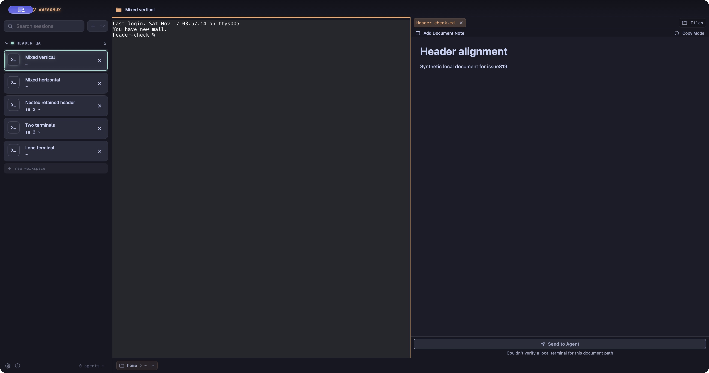
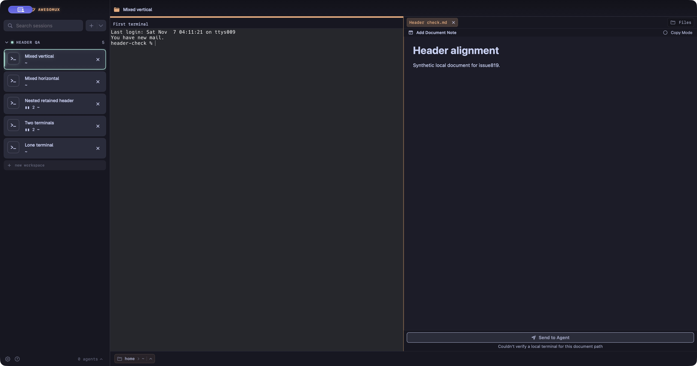

# Mixed split headers

Issue [#819](https://github.com/Interactive-Buffoonery/awesomux/issues/819): one terminal beside a document previously showed only a focus band. The terminal now uses its existing title bar, matching the document tab strip.

| Before | After |
| --- | --- |
|  |  |

These are unedited captures from separate local dev apps with disposable profiles and synthetic workspaces. Both use the same window dimensions. The terminal content starts 48 pixels lower after the change, matching the existing 24-point title bar at 2× scale.

Repeat the check with one terminal and a Markdown document, in side-by-side and stacked splits. In a nested layout with two terminals and a document, close the second terminal: the first title bar stays visible but its close button disappears. Add a terminal split again: the close button returns. Close the document: title bars remain if two terminals survive, and disappear if only one survives.

The terminal close button stays hidden for the final terminal. Use the existing workspace-close action to close that workspace.

Native checks confirmed these layout and close-control transitions. A separate focus issue was reproduced in both the unchanged baseline and candidate: after clicking document close, immediate typing can target the window instead of the terminal; clicking the surviving terminal restores input. This change does not claim to fix that issue. VoiceOver speech and minimum-width/display-scale coverage were not verified.
