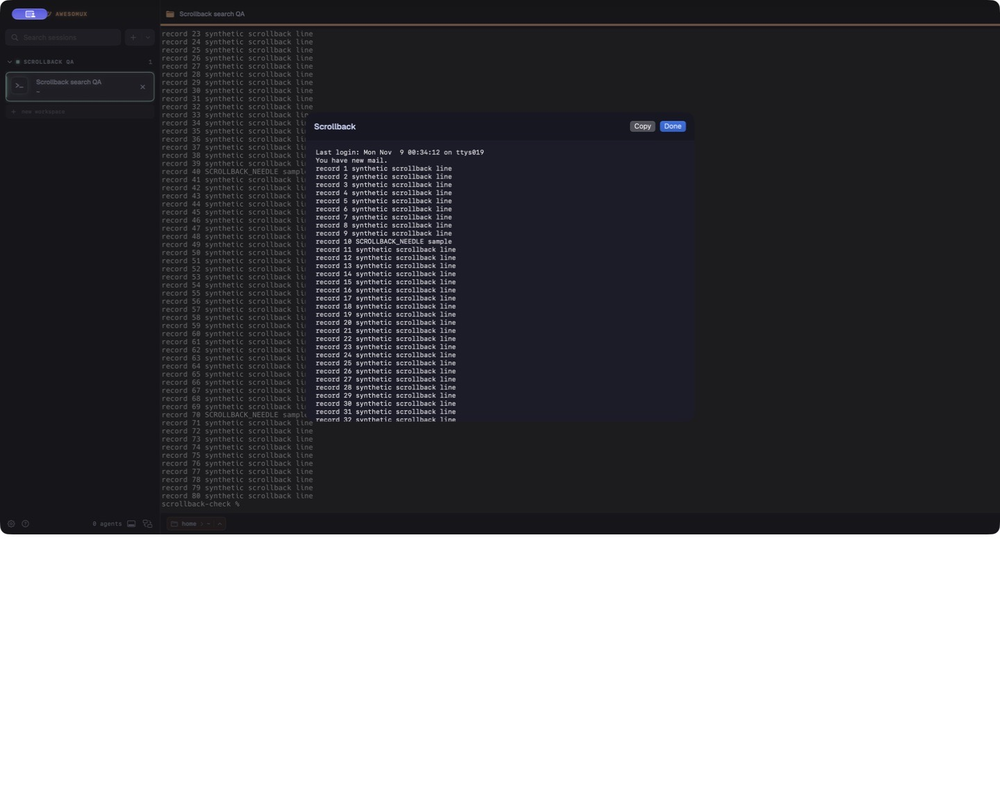
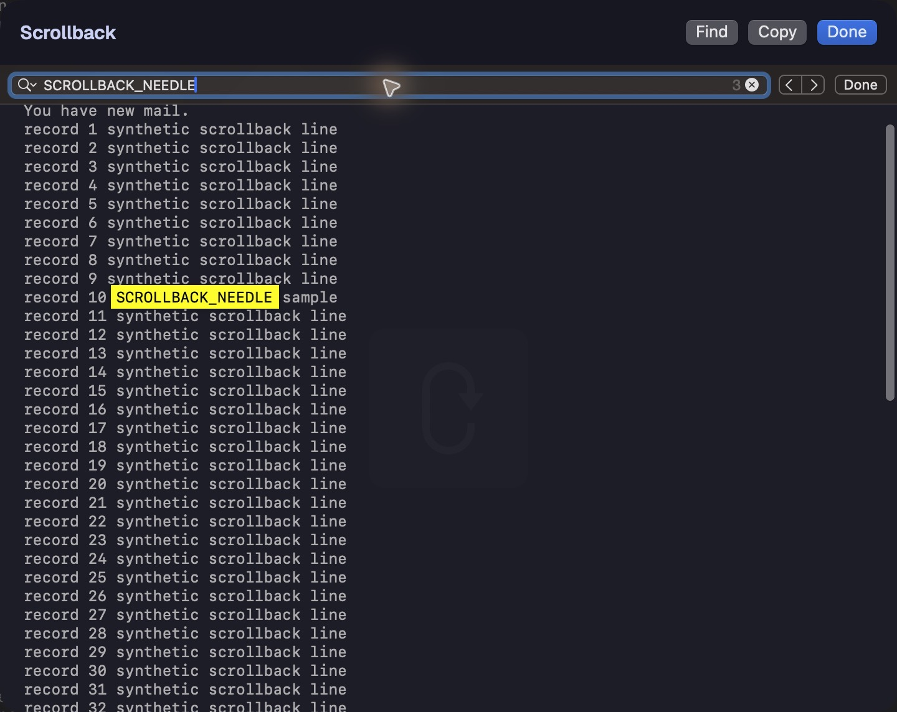

# Scrollback search

Isolated native captures with synthetic terminal output on macOS. The baseline is main `1387576b`; the candidate uses the same base with this contribution. The captures have different framing and do not establish a geometry comparison.

## Before

## After

The Find button and configured Find shortcut search only the immutable snapshot. Native Find query sharing follows macOS behavior. Escape closes the find bar first; a second Escape closes the sheet. The snapshot remains read-only. Actual VoiceOver speech and alternate display scales were not checked.
