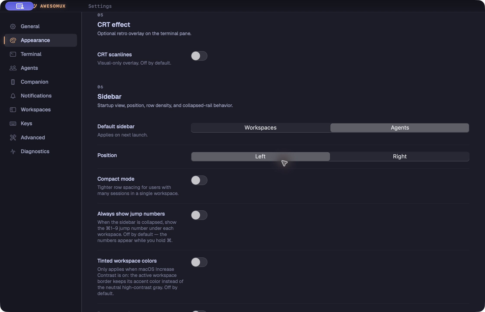

# Default sidebar setting

Captured from an isolated local development app with synthetic workspace data. The new choice uses the same segmented control treatment as Sidebar position. Workspaces remains the shipped default; choosing Agents applies on the next launch. Footer switches affect only the current window.

Native checks covered missing-key Workspaces startup, saved Agents startup, manual footer switching with a different saved default, Settings reopen, Appearance reset, and invalid-config write protection. Actual VoiceOver speech and alternate display/text scales were not verified.
